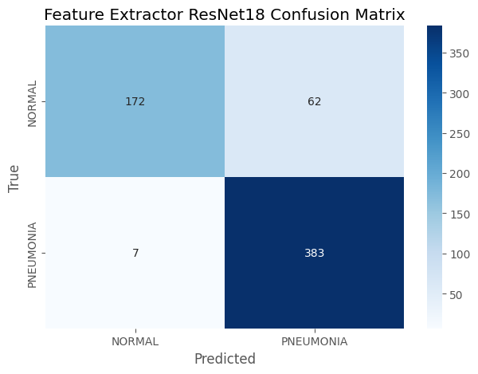
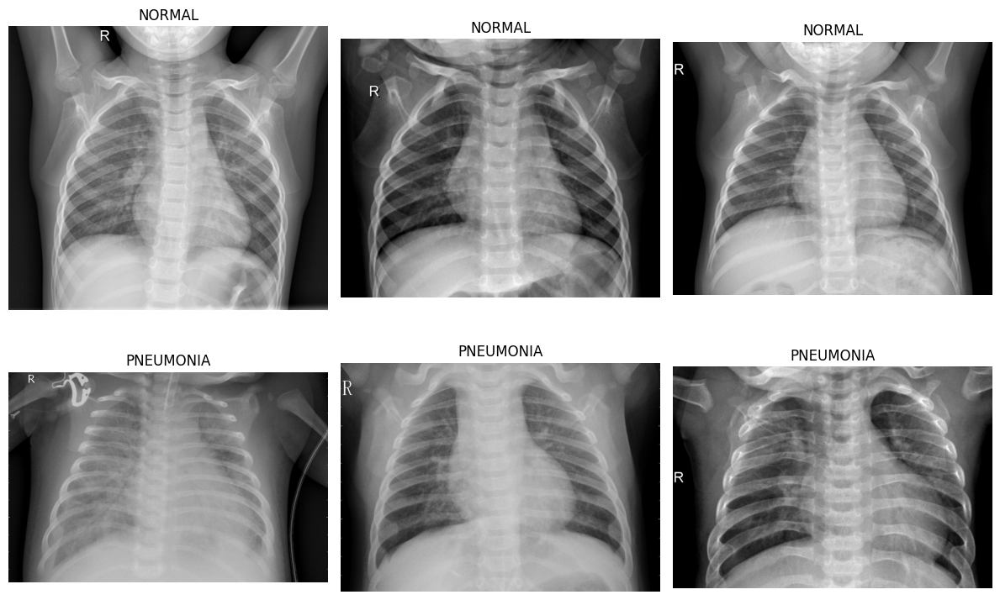
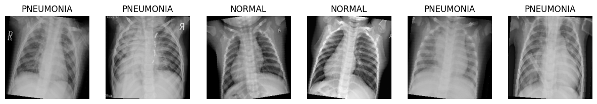
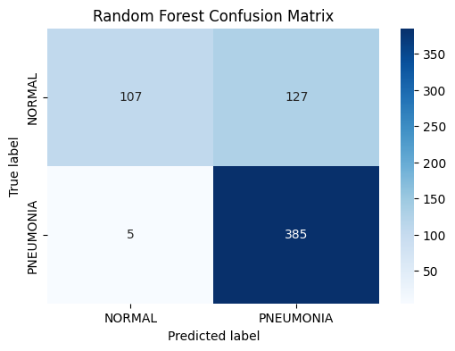
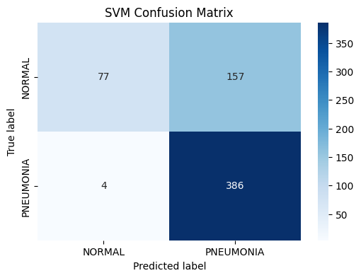
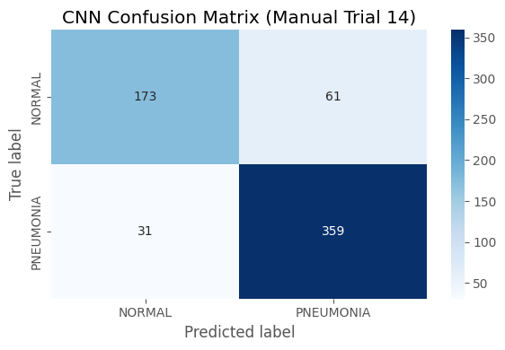

# Chest X-Ray Pneumonia Classification

Classifying pediatric chest X-rays as `NORMAL` or `PNEUMONIA`, comparing classical machine learning on hand-crafted HOG features against a custom CNN and transfer learning with ResNet18.

**Best result: 88.94% test accuracy** with a frozen ResNet18 feature extractor, catching 383 of 390 pneumonia cases (98% recall).

> This project is for educational and experimental purposes only. It is not intended for clinical diagnosis or medical decision-making.

---

## Results

All models were evaluated on the same held-out test set of 624 images (234 `NORMAL`, 390 `PNEUMONIA`).

| Model | Input | Test Accuracy | Normal Recall | Pneumonia Recall | Macro F1 |
|---|---|---:|---:|---:|---:|
| SVM (RBF kernel) | HOG features | 74.20% | 0.33 | 0.99 | 0.66 |
| Random Forest (Optuna, broad search) | HOG features | 78.69% | 0.47 | 0.97 | 0.74 |
| Random Forest (default, 100 trees) | HOG features | 78.85% | 0.46 | 0.99 | 0.74 |
| Random Forest (final, refined tuning) | HOG features | 79.81% | 0.50 | 0.97 | 0.75 |
| Custom CNN (Optuna, lowest validation loss) | Images | 81.09% | 0.53 | 0.98 | 0.77 |
| Custom CNN (Trial 14 config, retrained 8 epochs) | Images | 85.26% | 0.74 | 0.92 | 0.84 |
| **ResNet18 (frozen, ImageNet weights)** | Images | **88.94%** | **0.74** | **0.98** | **0.88** |

<p align="center">
  
</p>

### Key findings

- **Transfer learning wins.** ResNet18 with only its final layer trained beat every other model, combining the high pneumonia recall of the classical models with much better recall on normal X-rays.
- **Classical models over-predict pneumonia.** Every HOG-based model caught 97% to 99% of pneumonia cases but correctly identified only 33% to 50% of normal X-rays. The SVM labelled 157 of 234 normal images as pneumonia.
- **Tuning the Random Forest barely helped.** Two rounds of Optuna tuning moved test accuracy from 78.85% to 79.81%, which suggests the HOG feature set, not the hyperparameters, is the limit.
- **The custom CNN improved balance.** The Trial 14 configuration raised normal recall to 74% and gave the best precision balance (0.85 on both classes), at the cost of more missed pneumonia cases (31) than any other model.

---

## Dataset

[Chest X-Ray Images (Pneumonia)](https://www.kaggle.com/datasets/paultimothymooney/chest-xray-pneumonia) from Kaggle.

| Split | NORMAL | PNEUMONIA | Total |
|---|---:|---:|---:|
| Train | 1,341 | 3,875 | 5,216 |
| Validation | 8 | 8 | 16 |
| Test | 234 | 390 | 624 |

<p align="center">
  
</p>

What the exploratory analysis found:

- **Imbalanced training data:** 74.3% pneumonia vs 25.7% normal.
- **Very small validation set:** only 16 images, so each image is worth 6.25 percentage points of validation accuracy.
- **Widely varying image sizes:** from 384x127 to 2916x2663 pixels, averaging about 1321x968, so every image is resized before modelling.
- **No corrupted images:** the integrity check only flagged two `.DS_Store` system files.
- **Brightness and contrast:** mean pixel intensity of 121.74 with a standard deviation of 59.09 (0 to 255 scale, 100-image sample).

---

## Approach

### Classical pipeline

1. Convert to grayscale and resize to 128x128.
2. Extract Histogram of Oriented Gradients (HOG) features, giving 8,100 features per image.
3. Standardize and keep the 3,000 most informative features with `SelectKBest` (ANOVA F-test).
4. Balance classes with random oversampling (3,875 images per class).
5. Train a Random Forest and an SVM, then tune the Random Forest with two Optuna studies (50 broad trials, then 30 refined trials).

### Deep learning pipeline

1. Resize to 224x224 and normalize with ImageNet statistics.
2. Augment training images with random horizontal flips, rotations of up to 10 degrees and brightness and contrast jitter.
3. **Custom CNN:** a configurable architecture (1 to 5 conv layers, 1 to 2 dense layers, choice of activation, optimizer, dropout, batch norm and cross-entropy or focal loss) tuned with 30 Optuna trials.
4. **Transfer learning:** ResNet18 pretrained on ImageNet with all layers frozen except a new 2-class output layer, trained for 30 epochs with Adam.

<p align="center">
  
</p>

---

## Outputs

<p align="center">
  
  
  
</p>

---

## Repository Structure

```text
chest-xray-pneumonia-classification/
├── README.md
├── requirements.txt
├── data/
│   └── README.md
├── docs/
│   └── images/
└── notebooks/
    └── chest_xray_pneumonia_classification.ipynb
```

---

## How to Run

```bash
git clone https://github.com/vsaivivek26677/chest-xray-pneumonia-classification.git
cd chest-xray-pneumonia-classification
python -m venv .venv
source .venv/bin/activate
pip install -r requirements.txt
```

On Windows, activate the environment with `.venv\Scripts\activate` instead.

1. Download the [dataset](https://www.kaggle.com/datasets/paultimothymooney/chest-xray-pneumonia) and extract the `chest_xray/` folder into `data/`, as described in [`data/README.md`](data/README.md).
2. In the notebook's second code cell, set `base_dir = '../data/chest_xray'`.
3. Run `jupyter notebook`, open `notebooks/chest_xray_pneumonia_classification.ipynb` and run all cells.

A GPU is strongly recommended. In the original run the 30-trial CNN search alone took about 15 hours, and the ResNet18 section downloads pretrained weights the first time it runs.

---

## Limitations

- **Validation results are noisy.** With only 16 validation images, all 50 broad Random Forest tuning trials scored exactly 68.75% on validation, so Optuna had almost no signal to choose between them. Many CNN trials also tied.
- **"Best" checkpoints are not truly restored.** The training code stores `model.state_dict()` without copying it, so the saved "best" weights keep changing as training continues. Test results therefore reflect the final-epoch weights. For example, ResNet18 peaked at 93.75% validation accuracy but finished at 81.25%.
- **Some settings were chosen by hand.** The Trial 14 CNN and the final Random Forest settings (252 trees, `min_samples_leaf=7`) were set manually rather than taken straight from the search, so their test scores may be slightly optimistic.
- **Single test set:** results come from one split of one dataset and are not validated on external data.

---

## Tech Stack

PyTorch, torchvision, scikit-learn, scikit-image, imbalanced-learn, Optuna, NumPy, Matplotlib, Seaborn, Pillow.

---
